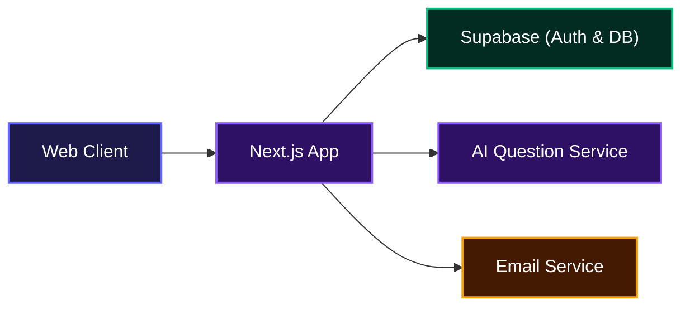
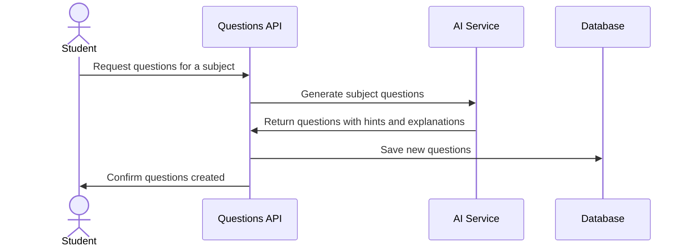
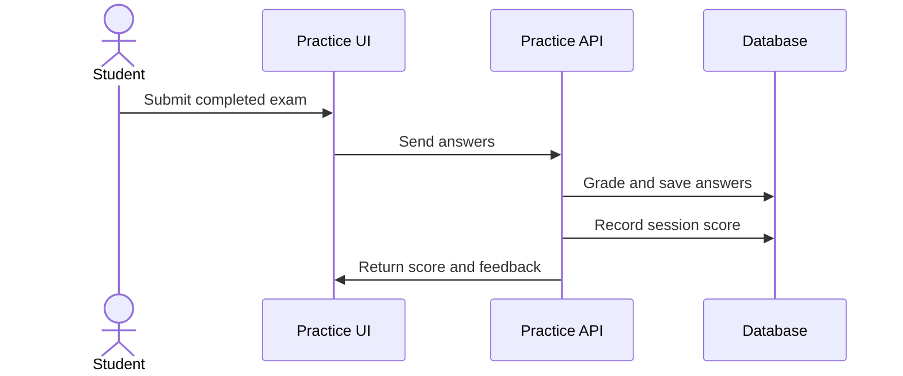

# ExamPrep.run

A smart, AI-powered exam preparation platform that helps students build personalized study plans, generate practice questions, and track their progress over time.

## Overview

ExamPrep.run takes the guesswork out of exam preparation. Students set up an exam, choose their subjects, and the platform generates a tailored question bank they can practice against. Everything from daily study goals to performance analytics is built to keep learners focused and improving.

Whether someone is studying for a university screening, professional exam, or custom test, ExamPrep.run gives them a clear path forward with CBT-style practice, instant feedback, and progress tracking.

## System Architecture



## Features

**Personalized Exam Setup**
Create an exam plan by selecting subjects, setting a target exam date, and choosing how much time to study each day. The wizard guides students through each step so nothing gets missed.

**AI-Generated Practice Questions**
The platform generates fresh questions for any subject on demand, complete with hints and explanations. If a subject does not have a question bank yet, it is created automatically.



**CBT-Style Practice Mode**
Students take realistic practice exams with a question navigator, flagging, progress tracking, and a clear results breakdown. Each answer is explained immediately so learning happens in real time.



**Progress and Insights**
Dashboards show accuracy trends, weekly practice volume, scores over time, and subject-level breakdowns so students always know where they stand.

## Usage

When students first visit the app, they land on the dashboard. From there, they can create a new exam or continue practicing an existing one.

To create a new exam:

1. Click "Create exam" on the dashboard or exams page.
2. Select the exam name or enter a custom one.
3. Pick the subjects to study.
4. Set daily study time and exam date.
5. Review the plan and start practicing.

During practice, students navigate questions with the question grid, flag items they want to revisit, and submit when finished. Results show a score breakdown per subject plus a full review of every question.

For development, start the dev server:

```bash
npm run dev
```

The app runs on `http://localhost:3000` by default.

## API Documentation

All API routes require a valid Supabase session cookie unless noted otherwise.

#### POST /api/auth/callback

**Description**: Compatibility bridge that redirects legacy Supabase OAuth callbacks to the client-side callback page so the PKCE exchange can run in the browser.

**Request**: Query parameters forwarded from the OAuth provider.

**Response**: HTTP 302 redirect to `/auth/callback`.

---

#### POST /api/emails/welcome

**Description**: Sends a welcome email to a newly registered user.

**Request**:
```json
{
  "email": "student@example.com"
}
```

**Response**:
```json
{
  "ok": true
}
```

**Errors**:
- 400: Invalid email address.
- 500: Failed to send welcome email.

---

#### GET /api/exams

**Description**: Returns all exams belonging to the signed-in user.

**Response**:
```json
{
  "exams": [
    {
      "id": "uuid",
      "name": "OOU ND Computer Engineering",
      "subjects": [...],
      "exam_date": "2025-08-15",
      ...
    }
  ]
}
```

**Errors**:
- 401: Unauthorized.
- 500: Failed to fetch exams.

---

#### POST /api/exams

**Description**: Creates a new exam preparation plan for the signed-in user.

**Request**:
```json
{
  "name": "OOU ND Computer Engineering",
  "institution": "Olabisi Onabanjo University",
  "exam_date": "2025-08-15",
  "daily_minutes": 60,
  "level": "beginner",
  "subjects": ["Mathematics", "Physics", "English Language"]
}
```

**Response**:
```json
{
  "exam": {
    "id": "uuid",
    "name": "OOU ND Computer Engineering",
    ...
  }
}
```

**Errors**:
- 400: Missing name or subjects.
- 401: Unauthorized.
- 500: Failed to create exam.

---

#### PATCH /api/exams/[examId]

**Description**: Updates an existing exam's details, subjects, or schedule.

**Request**:
```json
{
  "name": "Updated Exam Name",
  "subjects": ["Mathematics", "Chemistry"],
  "daily_minutes": 45
}
```

**Response**:
```json
{
  "exam": { ...updatedExam }
}
```

**Errors**:
- 400: Invalid payload or no subjects selected.
- 401: Unauthorized.
- 404: Exam not found.
- 500: Failed to update exam.

---

#### DELETE /api/exams/[examId]

**Description**: Deletes an exam and its related data for the signed-in user.

**Response**:
```json
{
  "ok": true
}
```

**Errors**:
- 401: Unauthorized.
- 500: Failed to delete exam.

---

#### POST /api/exams/[examId]/questions

**Description**: Ensures an exam has a fresh set of generated questions, creating them if needed.

**Response**:
```json
{
  "count": 25
}
```

**Errors**:
- 401: Unauthorized.
- 404: Exam not found.
- 500: Question generation failed.

---

#### GET /api/questions

**Description**: Lists available practice questions, optionally filtered by subject.

**Query Parameters**:
- `subject_code` (optional): Filter by subject code.
- `limit` (optional): Max number of questions, capped at 100.

**Response**:
```json
{
  "questions": [
    {
      "id": "uuid",
      "subject_code": "MATH",
      "question": "Solve for x...",
      "passage": null,
      "hint": "Isolate the variable...",
      "options": [...],
      "source": "ai",
      "sort_order": 0
    }
  ]
}
```

**Errors**:
- 401: Unauthorized.
- 500: Failed to fetch questions.

---

#### POST /api/questions/generate

**Description**: Generates new AI questions for a subject and saves them to the database.

**Request**:
```json
{
  "subject_code": "MATH",
  "count": 5,
  "difficulty": "medium",
  "exam_type": "CBT"
}
```

**Response**:
```json
{
  "created": 5,
  "questions": [...]
}
```

**Errors**:
- 400: Missing or unknown subject code.
- 401: Unauthorized.
- 500: Question generation failed.

---

#### POST /api/practice/submit

**Description**: Submits a completed practice attempt, grades it server-side, and saves the results.

**Request**:
```json
{
  "exam_id": "uuid",
  "answers": [
    { "question_id": "uuid", "selected_index": 1 },
    { "question_id": "uuid", "selected_index": 3 }
  ]
}
```

**Response**:
```json
{
  "session": {
    "id": "uuid",
    "user_id": "uuid",
    "exam_id": "uuid",
    "total_questions": 20,
    "correct_answers": 15,
    "score_percent": 75
  }
}
```

**Errors**:
- 400: Invalid exam_id, missing answers, or no valid answers provided.
- 401: Unauthorized.
- 404: Exam not found.
- 500: Failed to grade or save answers.

## Environment Variables

Create a `.env.local` file with the following values:

```env
# Required public Supabase config
NEXT_PUBLIC_SUPABASE_URL=https://your-project.supabase.co
NEXT_PUBLIC_SUPABASE_PUBLISHABLE_KEY=your-anon-key

# Optional public app URL
NEXT_PUBLIC_APP_URL=https://examprep.run

# Required server secrets
SUPABASE_SECRET_KEY=your-service-role-key
RESEND_API_KEY=your-resend-api-key
EMAIL_FROM=onboarding@examprep.run

# AI provider config
AI_API_KEY=your-ai-api-key
AI_BASE_URL=https://api.openai.com/v1
AI_MODEL=gpt-4o-mini
```

## Technologies Used

| Technology | Purpose |
|------------|---------|
| [Next.js 16](https://nextjs.org/) | React framework for the full-stack app |
| [React 19](https://react.dev/) | UI library |
| [TypeScript](https://www.typescriptlang.org/) | Type-safe JavaScript |
| [Tailwind CSS 4](https://tailwindcss.com/) | Utility-first styling |
| [Supabase](https://supabase.com/) | Authentication and Postgres database |
| [Resend](https://resend.com/) | Transactional email delivery |
| [React Email](https://react.email/) | Email template rendering |
| [Sonner](https://sonner.emilkowal.ski/) | Toast notifications |

## Contributing

Contributions are welcome. If you find a bug or have an idea for improvement, open an issue or submit a pull request. Please keep changes focused and include clear commit messages.

## Author

Built by Deel Olade.

- LinkedIn: https://linkedin.com/in/deelolade
- X (Twitter): https://x.com/deelolade

## Badges

[](https://www.typescriptlang.org/)
[](https://nextjs.org/)
[](https://react.dev/)
[](https://tailwindcss.com/)
[](https://supabase.com/)

[](https://dokugen.samueltuoyo.com)